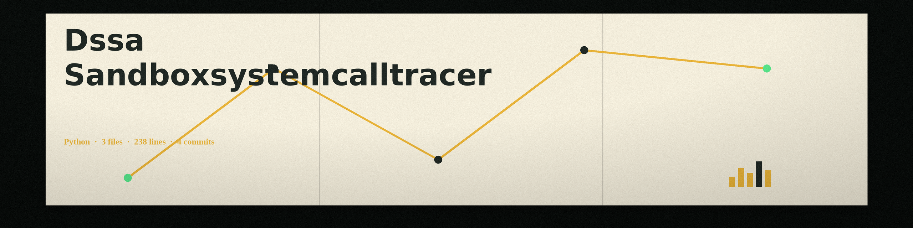

# dssa-SandboxSystemCallTracer
A lightweight utility that traces system calls made by a script it runs, using strace, and saves the system call entries, the command, the return code, and the captured output to a log. The default run is unsandboxed: the script runs with the operator's own rights, with no isolation. The sandbox path is opt-in only, through the --sandbox flag, which requires sudo and seccomp-tools. - Focused on Performs basic dynamic analysis of scripts (e.g., Python, JavaScript, VBScript). Focuses on identifying potentially malicious behaviors like file system modifications and network connections from the traced calls. Aims for minimal overhead and quick triage.

Notes on behaviour:
- The default run is unsandboxed. Only a run with --sandbox uses the sandbox path, and that path is opt-in.
- Tracing uses strace. If strace is not available at run time, the tool prints a plain line naming the missing tracer and exits 1 instead of producing a fake trace.
- A bare interpreter name such as python3 is resolved through the system path, and a full path is also accepted.
- If the traced script exits non-zero, the tracer logs that code and exits with the same code.
- If the output path given with -o resolves to the script itself, the run refuses at exit 1 and the script is unchanged.

## Install
`git clone https://github.com/ShadowStrikeHQ/dssa-sandboxsystemcalltracer`

## Usage
`./dssa-sandboxsystemcalltracer [params]`

## Parameters
- `-h`: Show help message and exit
- `--interpreter`: No description provided
- `--timeout`: No description provided
- `--log-level`: No description provided
- `--output`: Path to save the system call trace log.
- `--sandbox`: No description provided
- `--command-line-args`: Arguments to pass to the script.

## License
Copyright (c) ShadowStrikeHQ
